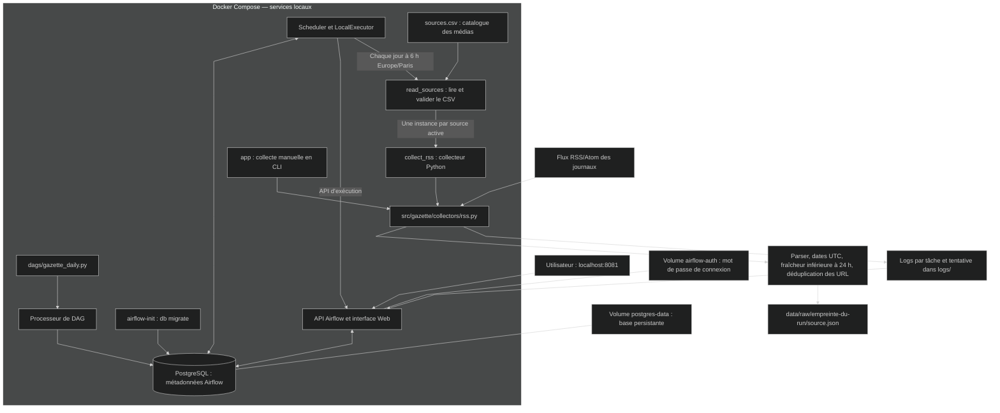
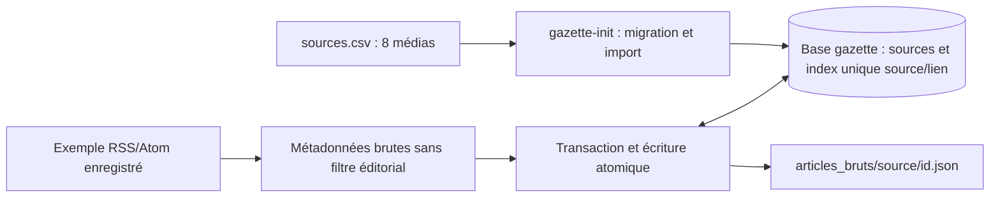
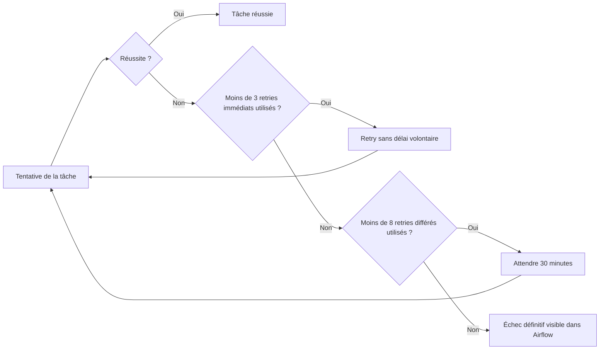
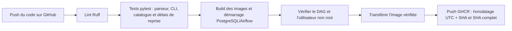

# Architecture — Gazette MDJA

## Architecture actuelle

Docker Compose déploie Airflow 3.3.2 et PostgreSQL. Le collecteur Python lit une
source RSS/Atom et conserve ses métadonnées filtrées dans un fichier JSON.
Le catalogue contient les huit médias avec les URL fournies par l'équipe.
Le nouveau stockage brut est prêt ; son raccordement au collecteur attend l'étape 3.
La commande app conserve Le Monde par défaut pour la démonstration initiale.

Le service `airflow-init` s'arrête après une migration réussie. Les autres services
attendent cette initialisation et leurs contrôles de santé. L'authentification locale
utilise SimpleAuthManager ; les secrets de connexion sont générés dans `.env`, hors Git.

PostgreSQL stocke actuellement les états et l'historique Airflow. Les articles ne sont
pas encore insérés dans une base métier. Les archives JSON sont organisées par run ;
une reprise du même run remplace atomiquement son fichier sans créer de doublon de fichier.
Le XML RSS brut et le texte intégral des articles ne sont pas archivés.

## Stockage métier ajouté à l'étape 2

La base `airflow` conserve l'orchestration ; la nouvelle base `gazette` conserve
le catalogue et l'index des fichiers. Le collecteur multi-sources devra appeler
ce stockage. Le sommeil et les en-têtes conditionnels attendent les prochaines étapes.
Voir [donnees.md](donnees.md) pour le contrat et les tests sans doublon.

## Planification et reprises

Le DAG `gazette_daily` est planifié à **6 h Europe/Paris**, avec `catchup=False` et
`max_active_runs=1`. Il est créé en pause lors d'une nouvelle installation ; le planning
doit être activé dans Airflow. Le poste, Docker et les services doivent rester disponibles.

Chaque tâche dispose d'une tentative initiale, puis de **11 retries au maximum** :

| Tentatives | Attente après l'échec précédent |
|---|---|
| 1 | Première tentative |
| 2 à 4 | Aucun délai volontaire : 3 retries immédiats |
| 5 à 12 | 30 minutes : jusqu'à 8 retries supplémentaires |

La politique `GazetteRetryPolicy` calcule le délai à partir du numéro de tentative.
Elle utilise l'API RetryPolicy d'Airflow 3.3 ; le backoff exponentiel est désactivé
pour respecter exactement les deux phases. Une réussite termine immédiatement la tâche.
Un retry dit immédiat reste soumis à la disponibilité du scheduler et des ressources.
Les exceptions qu'Airflow rend non rejouables ne sont pas concernées par cette politique.

Les huit délais représentent **4 h d'attente par tâche**, auxquelles s'ajoutent les
durées d'exécution et de planification. Chaque tentative est limitée à 3 minutes.
Le timeout global du DAG est porté à **10 h** pour permettre les reprises des deux
étapes successives, lecture des sources puis collecte, sans coupure à l'ancien seuil de 45 min.
Une source se relit à l'heure réelle de la reprise : la fraîcheur de 24 h est calculée
au moment de cette nouvelle collecte, pas à 6 h fixe.

## Images Docker et intégration continue

Le `Dockerfile` principal construit l'application légère en plusieurs étapes et propose
une cible `test`. L'image finale du collecteur utilise un utilisateur non root.
L'image Airflow est définie séparément dans `infra/airflow/Dockerfile`.

Un échec bloque les étapes suivantes. Les pull requests et lancements manuels vérifient
sans publier. La CI ne collecte pas la presse : elle utilise des fixtures et du HTTP local.
L'image publiée sur GHCR contient le collecteur ; GHCR ne stocke pas les articles collectés.

## Suite du projet

Le regroupement des thèmes, les synthèses, le stockage PostgreSQL des articles, les
alertes externes et la publication unique de la gazette à 7 h restent à développer.
Les retries prolongés permettent une collecte tardive ; ils ne garantissent pas une
publication à 7 h. Aucun scraping de secours n'est implémenté dans le collecteur actuel.
