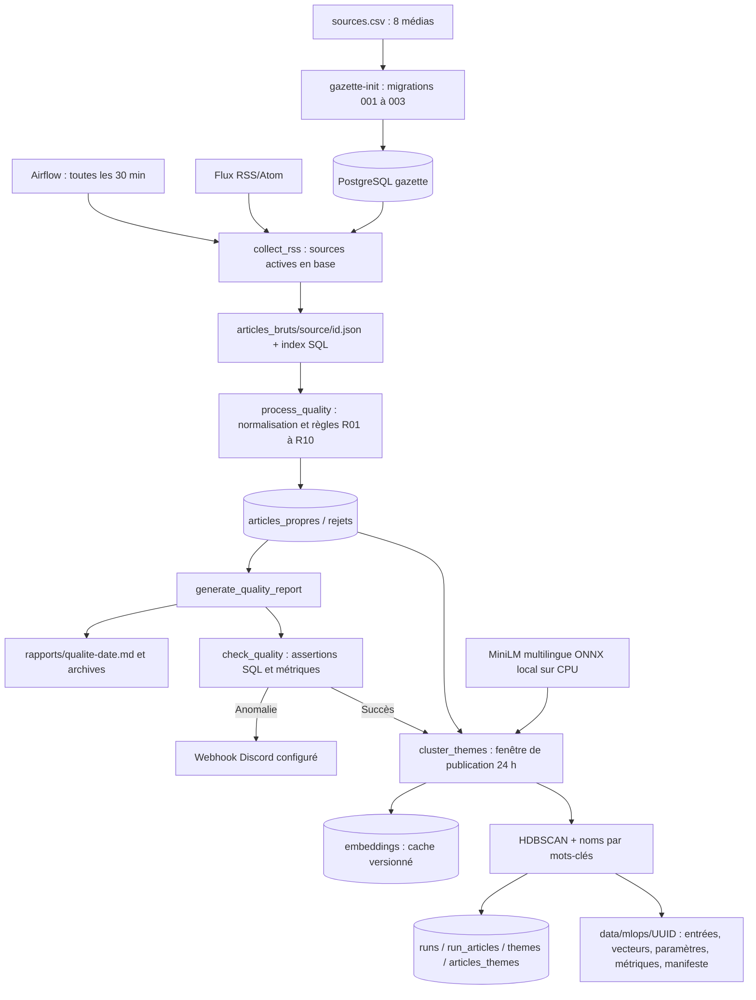

# Architecture actuelle — TD4 et TD5

Mise à jour du 12 novembre 2026. Docker Compose assemble PostgreSQL 16.6 et
Airflow 3.3.2 avec LocalExecutor, API/interface, scheduler et processeur de DAG.

La base `airflow` garde l'état technique et l'historique des tâches. La base `gazette`
garde les données métier. Les JSON, rapports, logs, artefacts et cache du modèle
sont persistants sur l'hôte. Les secrets restent dans `.env` ; aucun secret dans Git.

Le nouveau stockage brut est idempotent sur `(source,lien)`. L'ancien collecteur
`app` vers `data/raw/` est conservé pour la démonstration initiale ; le DAG utilise
le collecteur multi-sources vers le nouveau stockage.

Erreurs transitoires : au plus trois tentatives avec backoff de 1 et 2 secondes.
Les erreurs d'une source sont isolées ; trois cycles échoués la mettent en sommeil.
Un run de collecte vert ne garantit pas que tous les médias ont répondu.
Le filtrage et le contrôle SQL partagent une tolérance de cinq minutes sur les dates.

Le DAG n'a pas de retries Airflow, pas de catchup et un seul run actif. Il est borné
à quarante minutes, dont dix pour MLOps ; un run lent peut retarder le suivant.
Le modèle se télécharge à la première utilisation, dans une révision immuable,
puis les embeddings sont réutilisés par hash du texte et de la configuration.

Les thèmes historiques référencent des instantanés et les bruts, pas la table propre
recalculée. Un run MLOps publie thèmes et affectations dans une transaction.
Les expériences sont conservées, y compris les échecs. Aucun fine-tuning, LLM de
nommage, serveur d'embeddings externe ou publication d'édition n'est ajouté.

CI : lint → tests → build/import et sérialisation du DAG à cinq tâches → tests
PostgreSQL → push GHCR selon les règles du workflow. Aucun téléchargement de modèle
n'est requis pour les tests automatiques. Le vrai modèle a été vérifié localement.

Voir [données](donnees.md), [qualité](qualite.md), [MLOps](mlops.md) et
[validation TD4](validation-td4.md). La collecte automatique exige que le poste,
Docker et le DAG restent actifs ; ceci n'est pas encore un déploiement de production.
