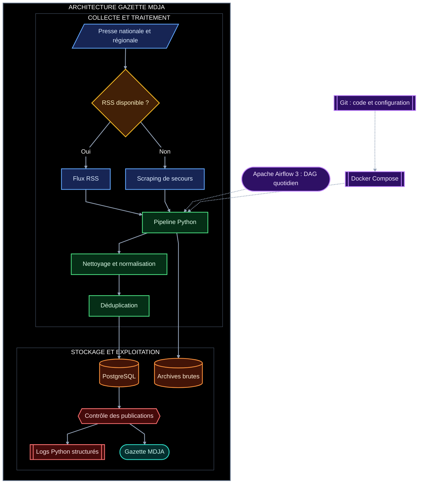
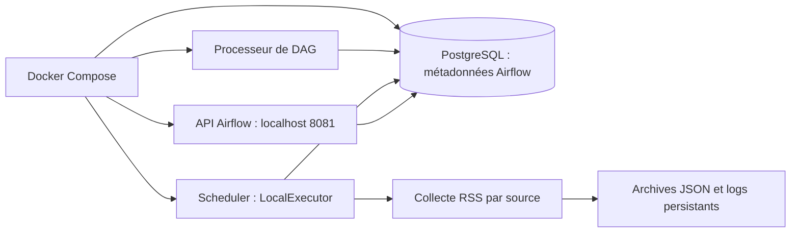

# Architecture — Gazette MDJA

## Schéma d'architecture

## État du prototype Airflow

Le schéma ci-dessus représente la cible métier. Le premier palier implémente uniquement
la collecte RSS et les archives JSON. Le scraping de secours, le stockage métier, le
regroupement et la publication ne sont pas encore implémentés.

Le DAG est programmé à 6 h Europe/Paris et créé en pause. Aucun service de publication
n'est encore actif. Les archives sont propres à chaque run et remplaçables lors d'un retry.
